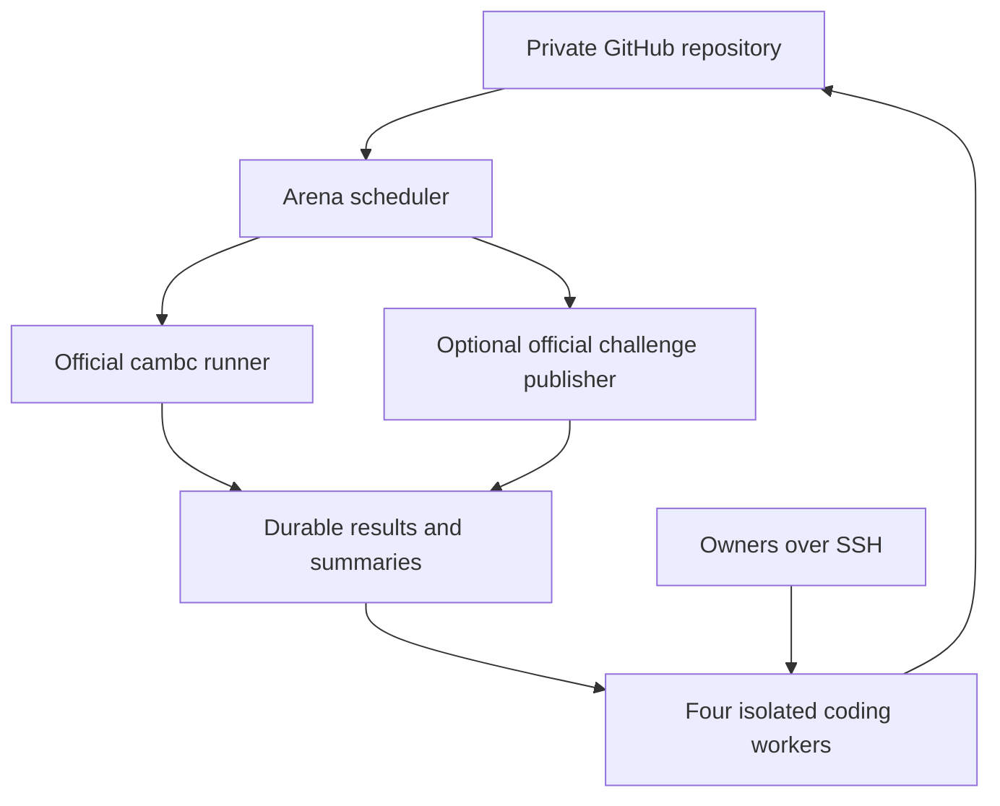

# Battlecode arena: selected design

An initial two-owner implementation now lives in `arena/`, with `config/pilot.json`, an administrator installer, rootless engine bootstrap, systemd units and tests. See [operations and exact commands](ops/OPERATIONS.md), [implementation/acceptance status](docs/IMPLEMENTATION_STATUS.md), and [rules verification](docs/rules/verified.md). The pilot overrides the original four-lane design below: alpha/beta only, one match/build/Codex job, and official automation disabled. Deployment and real-engine acceptance remain pending; synthetic tests are labeled separately.

Revised 16 October 2026, Asia/Saigon, after reading the supplied rules and Python API exports in full. This is an implementation specification and prompt pack, not an installed service.

Use one persistent CPU server for both the official game runner and the coding CLIs. Give each account owner an isolated worker and bot branch. A small Python supervisor runs bounded improvement jobs, evaluates immutable candidates, and saves feedback until the owner returns. GitHub stores code; the server stores match artifacts.

The realistic promise is **continuous service availability and automatic resumption**, subject to host availability. Subscriptions do not guarantee continuous model inference. When every account is limited, the arena can finish queued matches, run useful non-LLM experiments, and retain everything for the next available worker.

## What was verified

The current contest is Cambridge Battlecode Autumn 2026. The official distribution endpoint and PyPI agree on CLI version **2.1.6**. I downloaded that package, checked its wheel and binary hashes, ran the CLI help commands, and inspected the generated SDK and starter bot. This game has champion drafting, camps, gold, gems, altars, visibility, abilities, and team memory. Older Cambridge mining-game instructions are unsuitable.

The user subsequently supplied **GameRules.md (792 lines) and BotAPIPython.md (6,689 lines)**. Both were read completely and unchanged copies are included under sources/. They resolve the published game mechanics, all included champion specifications and exported Python API. BOT_REFERENCE.md gives the practical implications, API example defects and remaining wording conflicts.

The current documented target is 1,000 tributed gems / 2,000 rounds; ties compare lifetime earned gold, champion kills, then Team B after submitted gems. Live team memory is only 8 bytes, with a separate 1,024-byte draft buffer. Python has 25× the 100k C++/Rust fuel allowance, OCaml 5×. Fuel exhaustion suspends a bot until a later turn rather than automatically crashing it. Effective runtime settings still need measurement.

The website application remains inaccessible in this session. The separate organizers' AGENTS.md was **not included** in the two exports. Event participation/AI policies, official challenge UI, automation permission, quotas, submission-selection behavior, and replay access are still unverified. These are explicit setup checks in RULES_CHECKLIST.md. There is no invented challenge API in this design.

The CLI already has local match, batch, replay, build, and submission facilities. We should wrap the official engine rather than reproduce the game. See RESEARCH.md and evidence/cli-help.txt for the exact inspected interface.

## Architecture



All boxes except GitHub and the owners' computers run on one server. The challenge publisher interacts with the contest platform, not with the local runner.

| Component | Choice | Purpose |
|---|---|---|
| Host | Persistent Linux x86-64 CPU VM | Runs after laptops disconnect |
| Starting capacity | 8 vCPU, 16 GB RAM, about 100 GB persistent disk | Engineering starting point; benchmark before increasing concurrency |
| Smaller trial host | 4 vCPU, 8 GB RAM; one match at a time | Prove the workflow before sizing up |
| Scheduler | One Python process and SQLite on local disk | Durable jobs, evaluation, recovery |
| Simulation | Pinned official cambc CLI/SDK | Competition-compatible execution |
| Workers | Three Codex lanes and one Claude Code lane | Independent owner-authorized coding work |
| Isolation | Separate Linux users; rootless containers for builds/matches | Keeps bot execution away from login credentials |
| Lifecycle | systemd services | Restart after SSH disconnects and reboots |
| Feedback | Per-bot JSON/Markdown plus replay bundles | Agents read summaries, then selected evidence |
| Source exchange | Private GitHub repository, one branch per bot | Avoids concurrent edits to main |

No GPU is needed for this architecture: model inference is provided by the subscriptions; the rented server runs CLI processes, compilation, and simulation. Capacity is not a measured throughput promise. Avoid relying on an interruptible instance or ephemeral rental disk for the only copy of the arena state.

## Ownership and repository layout

Assign a durable bot ID once, for example `linh-codex-a1b2c3d4`. Do not regenerate it from the current hostname. Maintain an owner registry outside bot-controlled files.

| Lane | Branch | Initial research focus |
|---|---|---|
| Codex owner 1 | `bot/<id-1>` | Gem collection, banking, survival |
| Codex owner 2 | `bot/<id-2>` | Combat and champion abilities |
| Codex owner 3 | `bot/<id-3>` | Routing, vision, team coordination |
| Claude owner | `bot/<id-4>` | Draft/build choices and independent strategy review |

These are starting focuses, not permanent restrictions. Each lane maintains a complete playable bot, not a fragment requiring another worker to finish. Share compact findings through the arena; combine ideas only after a new combined candidate is tested. Keep diverse older opponents.

The implementation agent should create this repository structure:

```text
AGENTS.md
CLAUDE.md
ARENA.md
PLAYBOOKS.md
BOT_REFERENCE.md
RESEARCH.md
RULES_CHECKLIST.md
AUTH_AND_OPERATIONS.md
PROMPTS.md
config/
schemas/
arena/                    # scheduler, adapters, summarizer, worker supervisor
ops/                      # service definitions and installation instructions
bots/<bot_id>/src/         # source package for one complete bot
experiments/<bot_id>/      # small experiment records and persistent notes
docs/rules/               # authorized, versioned rules notes and source references
sources/                  # unchanged user-supplied GameRules.md and BotAPIPython.md
```

Every worker has a separate clone. Its branch is allowed to change only its own bot and experiment paths. The arena fetches exact commits from all registered branches; those branches do not need merging into main to play. Infrastructure comes from a separately pinned main commit. Match inputs are assembled from trusted SDK files and the selected bot subtrees, not arbitrary infrastructure from a bot branch.

Keep one long-lived branch per bot and add one normal commit per candidate update. Four bot lanes normally mean four persistent bot branches, not a growing branch per iteration. The accepted champion is tracked separately by source identity; a rejected commit can remain on branch history without replacing it.

## One improvement cycle

1. The supervisor confirms the worker is available and has no unfinished candidate evaluation.
2. It supplies the current accepted bot, recent feedback, a short research backlog, and a task ID.
3. The CLI reads AGENTS.md and the relevant playbook, diagnoses one problem, makes one change, and returns a structured result.
4. The non-LLM wrapper verifies changed paths and runs the approved smoke checks. It commits and pushes the candidate to the worker's branch. It does not force-push.
5. The arena detects that immutable revision, compiles it once per build identity, and schedules evaluation against frozen opponents with both side assignments.
6. The arena publishes feedback atomically. A tested candidate becomes that lane's accepted champion only if the configured promotion gate passes. Rejected candidates remain recorded.
7. The next CLI invocation starts from the accepted source and the new feedback. A candidate, a lane champion, and the team's official submission are three different things.

AGENTS.md does not keep a process running. The supervisor and systemd do that. Do not ask one chat session to remain alive and think forever.

## Local-machine use and offline recovery

The same bot worker can run on a laptop. It pushes code when online and pulls its latest feedback over SSH/SFTP when it returns. The arena never needs to open an inbound connection to the laptop. There is no lost-message window because results are stored by evaluation ID and source hash.

Only one writer may own a bot branch at a time. Pause the server lane and acquire a durable ownership lease before working locally. A laptop going offline does not automatically transfer ownership while it might still be editing. Release or explicitly transfer the lease before restarting the server worker.

## How to spend subscription usage usefully

Use one active invocation per account and initially at most two model jobs across the host. Allocate work to each owner's established lane; do not build an account-rotation pool that retries one account's quota-blocked task through another login. Separate users are an isolation measure, not a quota exemption.

Summarize statistics in code. Invoke an LLM only for a new, actionable feedback batch or a scheduled research question. Feed roughly 2–6k tokens of focused context as a starting budget, not all historical logs. Read full replays only to investigate specific failures. Avoid repeated website research, unnecessary tool integrations, and parallel agents inside each job by default. Measure accepted improvements and diversity gained, not tokens burned.

Use fresh task sessions and durable notes. Retain explicit session IDs only for recovering the same interrupted task; never resume an ambiguous `--last` session in a shared environment. Stop at the provider's limit and persist its reported reset time. No API billing, paid overage, or automatic credit purchase is part of this design.

## Official unranked challenges

Include a separate, optional external-evaluation lane. Initially an owner uploads a selected, evaluated bundle, launches the unranked challenge in the official UI, and imports the permitted replay and metadata. That works without guessing endpoints.

Automation can be enabled later if the platform rules permit it and its supported integration is verified. One publisher owns the team submission identity. It records our exact source/bundle hash, official submission ID, opponent identity/version if exposed, map, time, match ID, and result. If a challenge can use only the team's active submission, serialize changes to that submission and challenge only the promoted bot.

Rotate among strong teams and different opponent styles. A conservative local policy might allow one outstanding challenge, at least 30 minutes between starts, and at most 12 per day; these are **proposed self-imposed limits, not verified contest quotas**. Any stricter official limit wins. Unranked does not imply free, unlimited, private, or eligible for automation. A public team's bot cannot be simulated locally unless its code or executable is legitimately available.

## Rollout order

1. **Prove the runner:** finish the rules check, pin the engine/toolchain/maps, and run complete starter-versus-starter games with final statistics.
2. **Prove the arena:** one bot lane, immutable revisions, both sides, saved feedback, restart recovery.
3. **Prove one subscription worker:** owner login, one bounded task, publish, evaluation, another task, quota pause.
4. **Add the other lanes:** one at a time; confirm ownership and credential isolation.
5. **Add external checks:** manual challenge/import first, then supported automation if permitted.

Begin with PROMPTS.md's arena implementation prompt. The files specify the desired implementation; commands such as `arena-client` and `bot-check` are to be created by that implementation agent. They are not existing contest commands.
